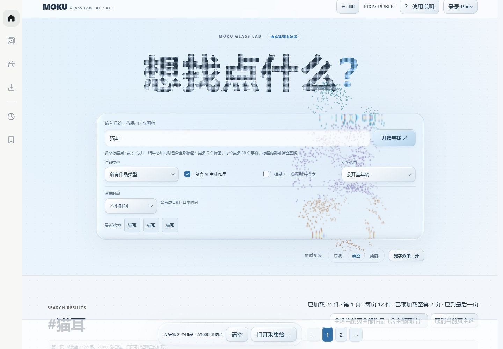
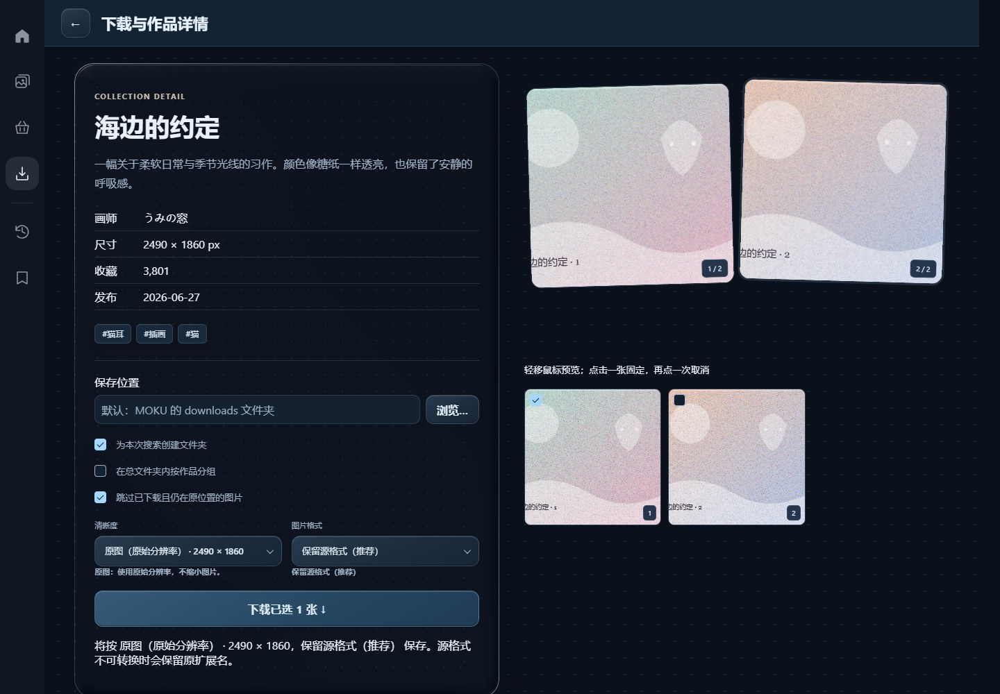

# MOKU Glass Lab R11 · 动效 MAX

<p align="center">
  
</p>

MOKU 是一个轻巧的 Windows Pixiv 搜图工具。输入标签、画师或作品 ID，翻翻预览，把喜欢的画放进采集篮，再挑好图片一起下载。

当前源码版本：**1.1.4-r1**（业务基线），动效版 **R11**，发布标记 `v1.1.4-glass-r11`。

`main` 现为动效 MAX 主线。原 Lite 版完整保存在 [lite-backup](https://github.com/Xirti/Pixiv-Bulk-Image-Downloader/tree/lite-backup)，对应 `v1.1.4-r1`。

**花里胡哨版，谨慎下载———若不喜欢可进入Release页面，下载前一个版本 `MOKU Lite-v1.1.4-r1`**。

主要更新了：清透玻璃、宽边折射、实时点阵背景和鼠标联动标题；详情、选图和下载延续 MOKU 的完整流程。

## 开始使用

从 [Releases](https://github.com/Xirti/Pixiv-Bulk-Image-Downloader/releases/tag/v1.1.4-glass-r11) 下载 Windows x64 压缩包，完整解压后打开文件夹里的 `MOKU-Glass-Lab.exe`。便携版直接运行，无需安装 Python。

需要 Windows 10/11 x64、Microsoft Edge WebView2 Runtime，以及能够访问 Pixiv 和图片 CDN 的网络。程序文件放在同一个文件夹里，保留`MOKU-Glass-Lab.exe.config` 。



首页提供厚润、清透、柔雾三种材质；日夜视图切散。

## 搜索与筛选

- 支持标签、画师和作品 ID 搜索。`pid:123456` 查作品，`uid:123456` 查画师，`author:画师名` 按名字查找；全角冒号也能用。
- 多标签严格 AND 搜索：用 `;` 或 `；` 分隔，如 `cat;night city`，标签内的空格照常保留。最多 6 个不同标签，每个最多 60 个字符；超限时会提示修改。
- 可筛选插画、漫画、动图，或排除 AI 生成作品。
- 发布时间可选今天、近 7 天、近 30 天和自定义日期。想查某一天，把开始和结束设成同一天即可；日期按日本时间计算，包含首尾两天。
- 内容范围可选全年龄、R-18 或全部；R-18 需要登录有相应权限的 Pixiv 账号。

每页显示 36 个作品，先加载当前页，再提前准备后续页面。短页可以点「继续加载本页」补齐，回退沿用本次搜索的结果，标签和画师搜索都不会因新作品发布而跳页。点击搜索会读取新结果；翻页和预取沿用这次搜索。

翻页时原来的图片会留在屏幕上，等新页准备好再切换；加载失败也能留在当前页重试。首页保留最近 8 次搜索，点击即可恢复标签、作品类型和日期等条件。作品的收藏数尚未获取时显示「—」，打开详情后可查看。

## 预览和采集篮

左侧图标栏连接搜索、预览选图、采集篮、下载、历史和收藏入口，鼠标停上去会显示名称。搜索和预览可以上下滚动，采集篮、下载与历史各有独立页面。收藏暂未开放。

在预览页勾选作品后进入采集篮，点击多图作品就能逐张挑选。采集篮支持任意数量的作品，最多选择 1,000 张图片；顶部的「清空」重置选择，「下载」前往下载设置。

采集篮会自动保存在本机。重开软件，之前挑好的作品和页码还在；缩略图在进入采集篮后按需加载。保存遇到问题时，当前选择会留在页面里，点击提示中的「重试保存」即可重新同步；继续改选也会尝试保存。

动图在鼠标悬停时播放，第一次加载先显示首帧，缓存后的预览再次悬停即可播放。首页顶部提供日夜切换、使用说明与 Pixiv 登录入口，页面、文字与弹窗一起换色。

输入框右键可剪切、复制、粘贴和全选，普通文字也能右键复制，键盘快捷键照常使用。



此处采用测试图片演示。

## 下载

先选择保存文件夹，再决定是否为本次搜索创建文件夹、是否按作品分组。单作品和采集篮共用下载设置，多图作品只下载勾选的图片。

清晰度默认选「原图」：保留 Pixiv 的原始分辨率。「标准」使用较小的预览图片，动图使用 600px 帧包，适合想节省空间时选择。

动图可以下载为三种格式：

- 原始帧 ZIP + JSON：保存各帧图片和播放时长，默认使用此格式。
- GIF：内置转换，可直接下载，保留透明背景；颜色会按 GIF 格式量化。
- MP4：使用本机 FFmpeg 导出 H.264 视频。安装支持 `libx264` 的 FFmpeg 并加入 PATH 后，重启 MOKU 即可使用。

很短的帧间隔不适合 GIF 时，界面会提示选择 MP4 或原始帧包。静态图片在混合下载中仍保留原来的格式。

默认跳过已经下载、仍在原位置的图片。换保存目录、清晰度或动图格式会分别下载，文件被删掉或修改后也能重新保存；想重新下载整批时，取消「跳过已下载」即可。预览卡片会标出本机已下载的页数。

未完成任务保留在下载页，重启后先暂停。点「继续」会沿用原来的图片选择、目录和格式，从剩余批次接着下载；失败的一批可以再次重试。「移除」只取消这项任务，已下载文件仍留在原位置。

最多保留 20 项未完成任务。满额时可以返回清理，也可以选择「本次直接下载」；直接下载会照常保存文件和历史，只是不保留重启后的恢复任务。

## 下载历史

历史页用一行展示作品、清晰度、格式、下载时间和文件路径，右侧可以打开保存位置、复制路径或删除记录。可以搜索记录、单条删除，也可以勾选多条一起删除；图片仍保留在原文件夹，下载去重记录也会保留。

记录从使用新版后的成功下载开始累积，重启后保留，最多保存最近 5,000 条。本地历史、文件目录、采集篮和未完成任务保存在 `%LOCALAPPDATA%\MOKU-Glass-Lab-01\library`，属于当前 Windows 用户。

## 登录与网络

点击右上角「登录 Pixiv」，在弹出的 Pixiv 官方页面完成登录。选择保持登录后，下次打开会继续使用已保存的账号会话。

MOKU 可使用 Windows 已开启的本地 HTTP 代理，也适配 TUN 网络。通过 `HTTPS_PROXY` 指定本机代理时，官方登录窗口也使用这条路线。遇到搜索或图片加载问题，可以打开「使用说明」里的网络检查，分别查看 Pixiv 网站和图片 CDN 的连接情况。

## 从源码启动

准备 Python 3.12 和 WebView2 Runtime，在项目目录运行：

```powershell
python -m pip install -r requirements.lock
python moku_app.py
```

## 打包

安装构建依赖后，运行项目自带的发布脚本：

```powershell
python -m pip install -r requirements-build.lock
powershell -ExecutionPolicy Bypass -File .\make-glass-release.ps1
```

便携程序生成在 `dist\MOKU-Glass-Lab`，发布压缩包、校验值和更新说明生成在 `release\v1.1.4-glass-r11`。版本配置与存储说明见 [EXPERIMENT.md](EXPERIMENT.md)。

## 本版更新

正式版基线为 `1.1.4-r1 Lite`，已归档至 `lite-backup`。当前主线聚焦液态玻璃与点阵交互，修复滚动时下拉菜单误关、玻璃恢复失败，并减少重复绘制。更新重点见 [RELEASE_NOTES.md](RELEASE_NOTES.md)，历史记录见 [CHANGELOG](CHANGELOG.md)。

## 许可证与作品使用

MOKU 使用 [MIT License](LICENSE)，是与 Pixiv 无隶属关系的独立项目。作品版权归各自创作者所有，下载和使用时请尊重作者授权及平台规则。
