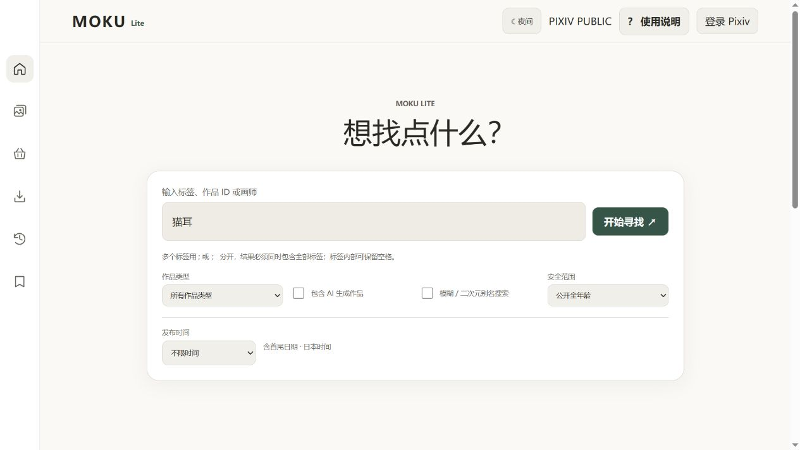
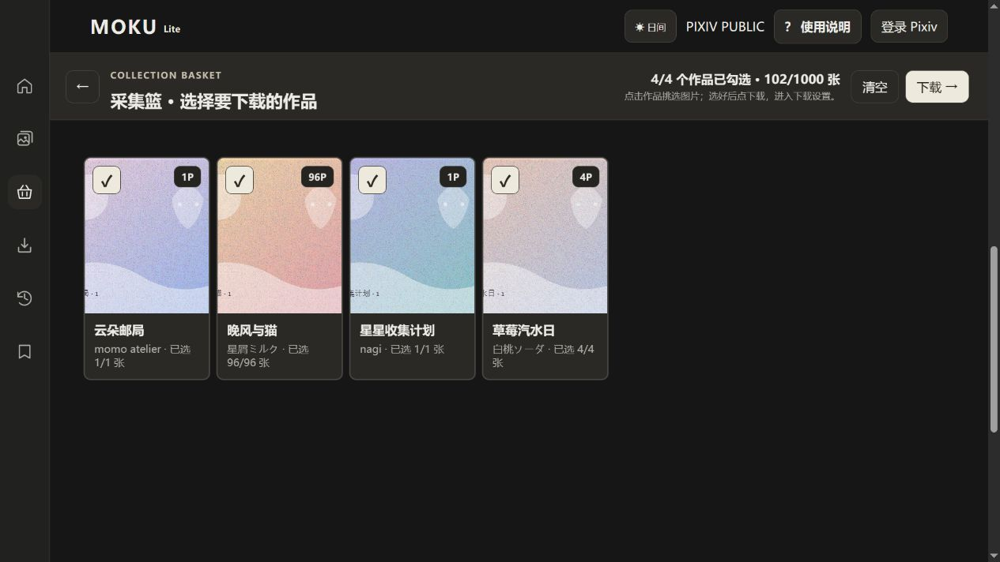
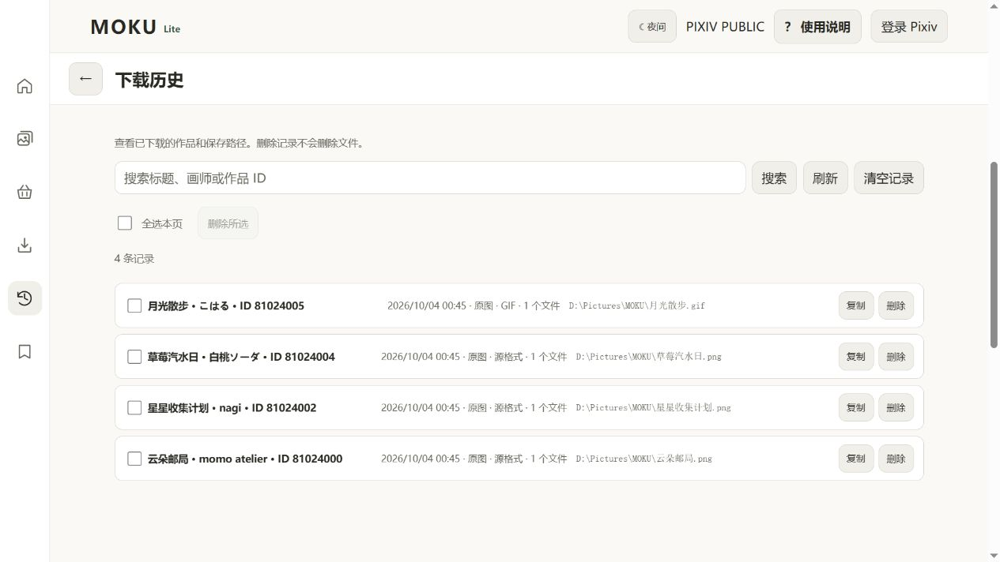

<p align="center">
  
</p>

<h1 align="center">MOKU Lite</h1>

<p align="center">Pixiv Tag Gallery · Windows 上的 Pixiv 搜图与批量下载工具</p>

<p align="center">
  <a href="https://github.com/Xirti/Pixiv-Bulk-Image-Downloader/releases/tag/v1.2.0">下载 v1.2.0</a> ·
  <a href="#开始使用">开始使用</a> ·
  <a href="RELEASE_NOTES.md">更新说明</a> ·
  <a href="https://github.com/Xirti/Pixiv-Bulk-Image-Downloader/issues">问题反馈</a>
</p>

按标签、画师或作品 ID 搜索 Pixiv，预览作品、逐张挑选，再把喜欢的图片一起保存到本机。`main` 为 Lite 正式源码。

## 功能

- **搜索与筛选**：多标签组合搜索，支持作品类型、AI 作品、发布时间和内容范围筛选。
- **预览与选图**：动图悬停播放，多图作品逐张选择，采集篮自动保存，最多选择 1,000 张图片。
- **批量下载**：选择原图或标准清晰度，自定义目录和作品分组，自动跳过已下载图片。
- **动图导出**：保存原始帧 ZIP + JSON，或合成为 GIF、MP4。
- **任务与历史**：暂停、继续未完成任务，搜索下载记录，打开文件位置或复制路径。
- **三档请求模式**：安全、普通、快速，默认安全模式；提供日夜主题、窗口贴靠和尺寸调整。

## 界面预览

**首页 · 日间模式**



<details>
<summary>查看采集篮与下载历史</summary>

**采集篮 · 夜间模式**



**下载历史**



</details>

截图来自 Lite v1.1.1；采集篮图片与历史记录使用演示数据。

## 开始使用

**运行环境：** Windows 10/11 x64、Microsoft Edge WebView2 Runtime，以及可访问 Pixiv 和图片 CDN 的网络。

1. 在 [v1.2.0 发布页](https://github.com/Xirti/Pixiv-Bulk-Image-Downloader/releases/tag/v1.2.0) 下载 `MOKU-v1.2.0-Lite-windows-x64.zip`。
2. 完整解压压缩包，打开文件夹里的 `MOKU.exe`。便携版已包含 Python 运行依赖。
3. 输入搜索内容，按需调整筛选条件，点击「开始寻找」。
4. 勾选喜欢的作品，在采集篮中挑选具体图片。
5. 前往下载页，选择保存位置、清晰度和格式，开始下载。

首次启动会打开使用说明；之后可从首页右上角再次打开。点击「登录 Pixiv」，在 Pixiv 官方页面完成登录；选择保持登录后，下次启动继续使用已保存的会话。

程序文件保持完整，`MOKU.exe.config` 与 `MOKU.exe` 放在一起。

## 使用说明

### 搜索

搜索栏的前缀选项可快速切换搜索方式，也可以直接输入：

| 输入示例 | 用途 |
| --- | --- |
| `猫耳` | 按标签搜索 |
| `猫耳;初音ミク` | 多标签搜索，结果同时包含全部标签 |
| `pid:123456` | 按作品 ID 查找 |
| `uid:123456` | 按画师 ID 查找 |
| `author:画师名` | 按画师名称查找 |

多标签用 `;` 或 `；` 分隔，最多 6 个不同标签，每个最多 60 个字符；标签内的空格照常保留，搜索前缀也支持全角冒号。

可筛选插画、漫画、动图和 AI 作品；内容范围提供全年龄、R-18、全部，R-18 使用具备相应权限的已登录账号。日期按日本时间计算，包含开始和结束当天；查某一天时，将两项设为同一天即可。

每页显示 36 个作品，短页可点击「继续加载本页」。翻页沿用本次搜索结果，重新搜索时刷新结果。首页保留最近 8 次搜索，点击即可恢复条件。

### 请求模式

在「使用说明 → 请求模式」中切换，选择自动保存。

| 模式 | 下载并发 | 搜索与预加载 |
| --- | --- | --- |
| 安全（默认） | 单路 | 请求间隔更宽松，优先处理前台操作 |
| 普通 | 自动调整，最多两路 | 空闲时准备后续页面 |
| 快速 | 自动调整，最多四路 | 更多页面预加载，提前准备动图帧包 |

搜索、预览和下载共用调度，遇到限频或临时网络异常会调整等待与并发。

### 下载与动图

「原图」保留 Pixiv 原始分辨率；「标准」使用较小的预览图片，动图使用 600px 帧包。静态图片保持原来的格式，动图可选择：

| 格式 | 说明 |
| --- | --- |
| 原始帧 ZIP + JSON（默认） | 保存各帧图片与播放时长 |
| GIF | 内置逐帧转换，支持透明背景；颜色按 GIF 格式量化，半透明边缘会合成处理 |
| MP4 | 使用本机 FFmpeg 导出 H.264 视频，透明区域合成为白底 |

导出 MP4 时，安装支持 `libx264` 的 FFmpeg 并加入 `PATH`，然后重启 MOKU。很短的帧间隔会提示选择 MP4 或原始帧包。

保存时可为本次搜索创建文件夹，也可按作品分组。默认跳过已下载且仍在原位置的图片；更换目录、清晰度或动图格式会分别保存，取消「跳过已下载」可重新下载。

### 采集篮、任务与历史

- **采集篮**自动保存在本机，重启后恢复作品与选中页码；保存失败时可点击「重试保存」。
- **未完成任务**最多保留 20 项，重启后以暂停状态恢复。「继续」沿用原来的选择和设置，从剩余批次接着下载；失败批次可重试，已完成批次保留。「移除」取消任务并保留已下载文件。任务满额时可清理旧任务，或选择「本次直接下载」。
- **下载历史**最多保留最近 5,000 条，可搜索、打开保存位置、复制路径和批量删除记录；删除记录后，图片和下载去重记录保留。

采集篮、未完成任务、下载历史和本地文件索引保存在 `%LOCALAPPDATA%\MOKU\library\`，属于当前 Windows 用户。

### 网络设置

支持 Windows 本地 HTTP 代理和 TUN 网络。通过 `HTTPS_PROXY` 指定本机代理时，Pixiv 官方登录窗口也使用相同路线。

遇到搜索或预览连接问题，可在「使用说明」中打开网络检查，分别查看 Pixiv 网站和图片 CDN 的连接情况。

<details>
<summary>高级设置：大动图预算与 MP4 编码器</summary>

在启动 MOKU 前设置环境变量，修改后重启程序：

| 变量 | 用途 | 默认值 | 可选范围 |
| --- | --- | --- | --- |
| `MOKU_UGOIRA_MAX_MIB` | 帧包与成品文件预算 | 512 MiB | 40–4096 MiB |
| `MOKU_UGOIRA_TEMP_MIB` | 解压帧与转换暂存预算 | 2048 MiB | 128–16384 MiB |
| `MOKU_UGOIRA_TIMEOUT_SECONDS` | 每件动图转换时限 | 600 秒 | 30–3600 秒 |
| `MOKU_UGOIRA_MP4_ENCODER` | MP4 编码器 | `cpu` | `cpu` / `nvenc` |

文件大小、临时空间和转换时间分别设置预算；提高预算时，为临时目录和保存目录预留相应空间。GIF 使用逐帧编码，MP4 直接处理原始压缩帧，减少中间文件读写。

MP4 默认使用 CPU 编码。具备 NVIDIA 显卡和相应 FFmpeg 的环境可选择 `nvenc`，编码器失败时转入 CPU 路径。

</details>

## 从源码运行

准备 Python 3.12、WebView2 Runtime，在 PowerShell 中运行：

```powershell
git clone https://github.com/Xirti/Pixiv-Bulk-Image-Downloader.git
cd Pixiv-Bulk-Image-Downloader
python -m venv .venv
.\.venv\Scripts\Activate.ps1
python -m pip install -r requirements.lock
python moku_app.py
```

## 构建便携版

在上述虚拟环境中安装构建依赖，并准备 Node.js 以执行 JavaScript 语法检查：

```powershell
python -m pip install -r requirements-build.lock
powershell -ExecutionPolicy Bypass -File .\make-release.ps1
```

便携程序生成在 `dist\MOKU\`，发布压缩包、校验文件和更新说明生成在 `release\v版本号\`。

## 问题反馈

欢迎通过 [GitHub Issues](https://github.com/Xirti/Pixiv-Bulk-Image-Downloader/issues) 提交问题或建议。反馈时附上版本号、操作步骤、报错文字和相关截图；作品下载问题可附作品 ID，方便定位。

## 许可证

本项目使用 [MIT License](LICENSE)。第三方组件见 [许可说明](THIRD_PARTY_NOTICES.md)，本地数据说明见 [隐私说明](PRIVACY.md)。

MOKU 是独立开发的 Pixiv 工具。作品版权归各自创作者所有，请按作者授权与平台规则使用。
